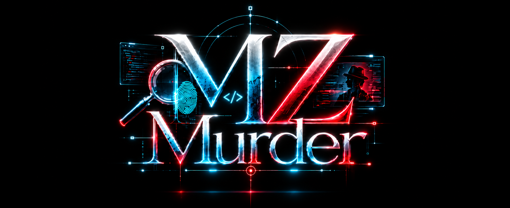

MZMurderはRPGツクールMZをオンラインマーダーミステリー制作ツールに変えます。

RPGツクールMZ をベースにした、オンライン向けのマーダーミステリー製作テンプレート / デモプロジェクトです。
Firebase Realtime Database を使って複数プレイヤーがデータを同期し、RPGツクールMZの強みである表示系、プログラム処理、自動動作を使って簡単にマダミスを制作することができます。

難しそうって思いましたか？
でも、プログラミングの知識なしで使えます。
Firebase Realtime Databaseの設定はブラウザからGUIでできるのでご安心を。
自分でサーバを用意する必要はありません。
そしてサーバの使用量はマダミスなら無料枠に余裕で収まります。

さらに、全てのプラグインは改変・再配布自由で、クレジット表記は不要です。
これを使ったことを作品のどこかに書く必要すらないのです。

現時点では正式版ではありません。11月15日に正式版リリース予定です。
といってもあとは実シナリオの動作確認だけです。

## 概要

- 対応基盤: RPGツクールMZ
- 通信基盤: Firebase Realtime Database
- 主要要素:
  - ルーム参加
  - PC選択
  - キャラクター移動・シーン遷移
  - 資料表示
  - 投票処理
  - カード・トークン管理
  - タイマー同期

## 参照マニュアル

- [制作マニュアル]
- [プラグイン一覧]
- [ContentRenderer HTMLガイド]

## 事前準備

- RPGツクールMZ をインストールしていること
- インターネット接続ができる環境があること
- 使用できるGoogleアカウントがあること

## 使い方の流れ

1. Firebase でプロジェクトを作成する
2. Authentication で匿名認証を有効化する
3. Realtime Database を作成し、必要な設定を入れる
4. RPGツクールMZ にプラグイン群を導入する
5. ルーム・参加者・マップ・イベントを作成する
6. 画像・資料・カード・トークンを配置する
7. 実機またはブラウザで動作確認する
8. 配布用データとして書き出しを行う

## 主要プラグイン

以下のようなプラグインが含まれています。

- FirebaseSync
- CharacterSelection
- SideMenu
- TabUI
- ContentRenderer
- CardPicture
- EnhancedPicture
- CulpritVote
- TimerEx
- SyncMapTransfer
- GMSceneManager
- FloatingMessageLog
- SequenceController
- LogicProcessor

詳細はプラグイン一覧を参照してください。

## 重要な注意事項

- Firebase の設定値（`apiKey` や `authDomain` など）は、ゲーム側の設定に反映させる必要があります。
- ゲーム内で使用するHTMLは特定のタグのみ使用する特殊な形式です。マニュアルを確認ください。
- スイッチや変数、カードは同期させることができ、イベントなどの実行は各PCが個別に行います。GMだけが実行する処理と全員が実行する処理を区別することを意識する必要があるでしょう。

## 開発・実行時メモ

- 開発時はローカルでのテストと複数端末での確認を行うと安全です。PCが複数台ない場合はWeb版を使用するとブラウザごとにクライアントになれます。
- 実運用前に、ルーム作成・参加・タイマー・投票・終了処理の一通りを確認してください。
- 配布時は、Windows環境ではRPGツクールMZ の「ファイル」→「デプロイメント」で出力したファイル一式をそのまま配布対象とするのが基本です。Mac版は最新のNWjsをご利用ください。

## ライセンス

めんどくさいことはいいんだよ派が作っています。改変も再配布もご自由に。作品にクレジット表記を入れる必要もありません。

## 参考

- [Firebase Web Setup](https://firebase.google.com/docs/web/setup)
- [RPGツクールMZ](https://www.rpgmakerweb.com/products/rpg-maker-mz)
- [NW.js](https://nwjs.io/)
